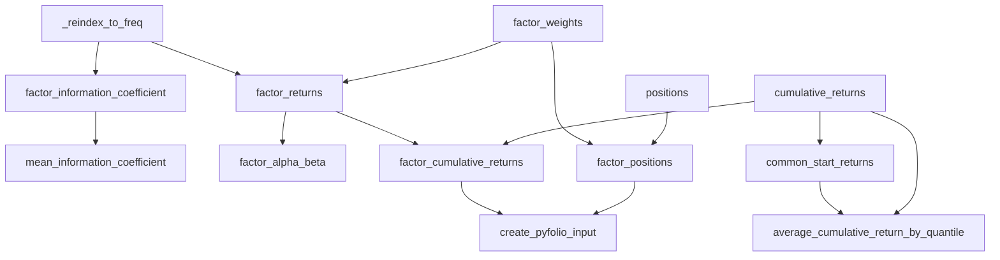

# `alphalens.performance`

Performance-analysis utilities for factor research, including information coefficient calculations, factor-weighted portfolio simulation, quantile analysis, event-study helpers, and Pyfolio-ready outputs.

This module is the main analytics layer used after factor data has been cleaned and aligned with `alphalens.utils.get_clean_factor_and_forward_returns()`.

## Dependency-based reading roadmap

Start with the [data model](#data-model-used-by-this-module): understand the `(date, asset)` index, forward-return horizons, quantiles, and optional groups. Then read the functions in the order below. Each stage builds on earlier stages; functions in the same stage can be read independently. Dependencies here refer to calls between functions defined in `performance.py`; see the [dependency table](#per-function-dependency-table) for utility and external dependencies.

| Stage | Functions to read | What to understand |
| --- | --- | --- |
| 1. Foundations | [factor_weights](#factor_weights), [cumulative_returns](#cumulative_returns), [positions](#positions), [_reindex_to_freq](#_reindex_to_freq-private-helper) | How signals become normalized weights, simple returns compound into wealth, overlapping allocations become positions, and date frequency metadata is preserved. These helpers do not call other module functions. |
| 2. First derived results | [factor_returns](#factor_returns), [factor_information_coefficient](#factor_information_coefficient), [common_start_returns](#common_start_returns) | `factor_returns` combines weights and forward returns, with frequency handling; IC uses the frequency helper; event windows use the cumulative-return helper when input is not already cumulative. |
| 3. Summaries and simulations | [factor_alpha_beta](#factor_alpha_beta), [mean_information_coefficient](#mean_information_coefficient), [average_cumulative_return_by_quantile](#average_cumulative_return_by_quantile), [factor_cumulative_returns](#factor_cumulative_returns), [factor_positions](#factor_positions) | Regression builds on factor returns, mean IC on date-level IC, and event summaries on aligned windows. Portfolio simulations combine filtering with return compounding or weight-to-position conversion. |
| 4. Combined output | [create_pyfolio_input](#create_pyfolio_input) | How cumulative portfolio returns and portfolio positions become daily strategy returns, positions with cash, and a benchmark. |

The following graph shows direct calls, with arrows pointing **from a prerequisite to its caller**. Conditional calls are included: `factor_alpha_beta` computes factor returns only when none are supplied, and `common_start_returns` compounds only when `cumulative=False`.



Read these independent diagnostics after the data model, whenever their question becomes relevant:

- [mean_return_by_quantile](#mean_return_by_quantile): how returns differ across signal buckets. Follow it with [compute_mean_returns_spread](#compute_mean_returns_spread) to compare two buckets at 100% gross exposure. This is a data-flow relationship; neither function calls the other.
- [quantile_turnover](#quantile_turnover): how quantile membership changes over a lag.
- [factor_rank_autocorrelation](#factor_rank_autocorrelation): how asset rankings persist over a lag.

[Back to TOC](#table-of-contents)

## Table of contents

- [Dependency-based reading roadmap](#dependency-based-reading-roadmap)
- [Data model used by this module](#data-model-used-by-this-module)
- [Core analysis functions](#core-analysis-functions)
  - [factor_information_coefficient](#factor_information_coefficient)
  - [mean_information_coefficient](#mean_information_coefficient)
- [Portfolio weighting and return simulation](#portfolio-weighting-and-return-simulation)
  - [factor_weights](#factor_weights)
  - [factor_returns](#factor_returns)
  - [factor_alpha_beta](#factor_alpha_beta)
  - [cumulative_returns](#cumulative_returns)
  - [positions](#positions)
- [Quantile and bucket analysis](#quantile-and-bucket-analysis)
  - [mean_return_by_quantile](#mean_return_by_quantile)
  - [compute_mean_returns_spread](#compute_mean_returns_spread)
  - [quantile_turnover](#quantile_turnover)
  - [factor_rank_autocorrelation](#factor_rank_autocorrelation)
- [Event-study helpers](#event-study-helpers)
  - [common_start_returns](#common_start_returns)
  - [average_cumulative_return_by_quantile](#average_cumulative_return_by_quantile)
- [Portfolio simulation outputs](#portfolio-simulation-outputs)
  - [factor_cumulative_returns](#factor_cumulative_returns)
  - [factor_positions](#factor_positions)
  - [create_pyfolio_input](#create_pyfolio_input)
- [Dependencies and implementation notes](#dependencies-and-implementation-notes)
  - [_reindex_to_freq (private helper)](#_reindex_to_freq-private-helper)
- [Per-function dependency table](#per-function-dependency-table)
- [Practical usage](#practical-usage)

## Data model used by this module

Most functions expect a MultiIndex `pandas` object indexed by:

- level 0: `date`
- level 1: `asset`

The input usually includes:

- a `factor` column
- one or more forward-return columns such as `1D`, `5D`, or `10D`
- `factor_quantile`
- optionally `group`

Forward-return column names are detected using `alphalens.utils.get_forward_returns_columns()`. Column requirements depend on the function: weighting needs `factor`, quantile analysis needs `factor_quantile`, and group-based operations need `group`. Group options remain disabled by default even when a `group` column is present.

**Return-horizon formats**

Forward-return column names can describe daily, intraday, or combined durations:

| Column name | Return horizon |
| --- | --- |
| `1D`, `5D` | 1 day, 5 days |
| `30m` | 30 minutes |
| `3h` | 3 hours |
| `90s` | 90 seconds |
| `500ms` | 500 milliseconds |
| `100us` | 100 microseconds |
| `10ns` | 10 nanoseconds |
| `1D1h` | 1 day plus 1 hour |
| `3D12h` | 3 days plus 12 hours |
| `1h30m` | 1 hour plus 30 minutes |

Use integer quantities followed by `D`, `h`, `m`, `s`, `ms`, `us`, or `ns`,
optionally combining multiple components without spaces. Here, `m` means
minutes. The detector is case-insensitive, but these spellings match the labels
generated by `utils.timedelta_to_string()`.

Names such as `1W`, `1B`, `30min`, and `1.5h` are not recognized as forward-return
columns by this implementation. Express a seven-day duration as `7D`,
30 minutes as `30m`, and 1.5 hours as `1h30m`. Business-day calendar behavior
comes from the trading calendar rather than a `B` suffix in the column name.

A return horizon describes how far ahead an asset's return is measured;
`DatetimeIndex.freq` describes the spacing of observations. They can differ:
hourly observations can have a `30m` forward-return column. Callers using
`get_forward_returns_columns(..., require_exact_day_multiple=True)` retain
only day-multiple labels such as `1D` and `5D`, excluding intraday and mixed
day/hour labels.

[Back to TOC](#table-of-contents)

## Core analysis functions

### `factor_information_coefficient`
**Signature:** `factor_information_coefficient(factor_data, group_adjust=False, by_group=False, ic_type="spearman")`

Compute the Information Coefficient (IC) between factor values and each forward-return horizon.

**Behavior**

- Calculates IC period by period using either:
  - Spearman rank correlation (`ic_type="spearman"`, default), or
  - Pearson linear correlation (`ic_type="pearson"`).
- When `group_adjust=True`, forward returns are demeaned within group before IC computation.
- When `by_group=True`, IC is computed and returned separately per group (group breakout only; no change to the IC formula).
- Drops missing factor/return pairs separately for each horizon. Returns `NaN` when fewer than two valid pairs remain or either input is constant.
- Reattaches the input date frequency when `by_group=False` and the result's dates conform to it; it does not add missing dates.
- Raises `ValueError` for unsupported `ic_type` values.

**Returns**

A `DataFrame` of IC values indexed by date, or by date and group when `by_group=True`.

[Back to TOC](#table-of-contents)

---

### `mean_information_coefficient`
**Signature:** `mean_information_coefficient(factor_data, group_adjust=False, by_group=False, by_time=None, ic_type="spearman")`

Compute the mean IC across the full sample or over a time window.

**Behavior**

- Forwards `ic_type` to `factor_information_coefficient()`: `"spearman"` (default) or `"pearson"`.
- Can aggregate by time period using a pandas time rule such as monthly or weekly windows.
- Can aggregate by group when `by_group=True`.

**Returns**

A `Series` indexed by forward-return horizon when neither time nor group aggregation is requested. Otherwise, a `DataFrame` indexed by time, group, or `(date, group)` according to the requested grouping.

[Back to TOC](#table-of-contents)

## Portfolio weighting and return simulation

### `factor_weights`
**Signature:** `factor_weights(factor_data, demeaned=True, group_adjust=False, equal_weight=False)`

Compute asset weights from factor values.

**Behavior**

- Factor values are normalized to gross leverage of 1 when exposure is nonzero.
- When `demeaned=True` and `equal_weight=False`, subtracts the mean factor before normalization to create dollar-neutral long-short weights.
- When `group_adjust=True`, constructs weights within each date/group and then normalizes across the date. Groups with nonzero exposure receive equal gross weight; dollar neutrality within each group additionally requires `demeaned=True`.
- When `equal_weight=True`, uses factor signs instead of magnitudes. With `demeaned=True`, first subtracts the median, then gives each side half the gross exposure when both sides exist. Assets equal to the median receive zero weight; ties can leave unequal numbers of long and short assets.
- A zero or missing gross normalization denominator returns the transformed values multiplied by zero; existing missing values remain missing.

**Why `to_weights` is applied twice when `group_adjust=True`**

- First pass (`groupby([date, group]).apply(to_weights, demeaned, equal_weight)`):
  compute and normalize weights *within each group* for each date.
- Second pass (`weights.groupby(level="date").apply(to_weights, False, False)`):
  combine all groups on that date and rescale exposures without re-demeaning or
  re-bucketing.
- This two-step process ensures both:
  - intra-group construction (including optional demeaning/equal-weight rules), and
  - date-level normalization so total gross leverage is 1.
- Without the second pass, concatenating already-normalized groups would typically
  produce gross leverage close to the number of groups.

**Worked example: normalizing across groups on the same date**

“Normalizes across the date” means combining all groups' weights for one date
and dividing every asset's weight by their total absolute sum. It operates
across assets on that same date, not across different dates.

Suppose `group_adjust=True` and `demeaned=True`, and the first pass produces
these weights for two groups on one date:

| group | asset | within-group weight | final portfolio weight |
| --- | --- | ---: | ---: |
| Tech | A | +0.50 | +0.25 |
| Tech | B | -0.50 | -0.25 |
| Energy | C | +0.50 | +0.25 |
| Energy | D | -0.50 | -0.25 |

Each group initially has gross exposure `1`, so combining them gives total
gross exposure `|0.50| + |-0.50| + |0.50| + |-0.50| = 2`. The second pass
divides every weight by `2`. The final portfolio has gross exposure `1`, with
each group contributing `0.50` of gross exposure.

More generally, with `G` groups having nonzero exposure on a date, this step
divides their within-group weights by `G`. Groups with all-zero weights remain
at zero. This preserves relative weights within each group and gives every
active group the same gross allocation, regardless of its asset count. It does
not demean weights again: dollar neutrality within each group comes from
`demeaned=True` in the first pass.

**Returns**

A `Series` of weights indexed by `(date, asset)`.

**Worked examples: all four weighting combinations**

Assume `group_adjust=False` and one date with factors
`(A, B, C) = (2.0, 1.0, -1.0)`. Every weight vector below follows the asset
order `(A, B, C)`.

| | `demeaned=False` | `demeaned=True` |
| --- | --- | --- |
| `equal_weight=False` | Normalize raw factors: `(2, 1, -1) / 4`. **Weights: `(0.50, 0.25, -0.25)`**. Long exposure `0.75`, short exposure `0.25`, net exposure `+0.50`. | Subtract the mean `2/3`: `(4/3, 1/3, -5/3)`, then divide by gross exposure `10/3`. **Weights: `(0.40, 0.10, -0.50)`**. Long exposure `0.50`, short exposure `0.50`, net exposure `0`. |
| `equal_weight=True` | Take raw factor signs: `(+1, +1, -1)`, then divide by gross exposure `3`. **Weights: `(+1/3, +1/3, -1/3)`**. Long exposure `2/3`, short exposure `1/3`, net exposure `+1/3`. | Subtract the median `1`: `(1, 0, -2)`. Take signs `(+1, 0, -1)`, balance the two sides, then normalize. **Weights: `(0.50, 0, -0.50)`**. Long exposure `0.50`, short exposure `0.50`, net exposure `0`. |

All four portfolios have gross exposure `1`; short exposure above is shown as
an absolute amount. With `demeaned=False`, long and short exposures need not
balance. With `equal_weight=True`, all-positive raw factors produce a long-only
portfolio when `demeaned=False`, while zero factors receive zero weight.

With `equal_weight=True` and `demeaned=True`, equal weighting applies within
each side. The code divides each nonzero sign by the number of assets on its
own side before the final gross normalization. Assets equal to the median
receive zero weight, even if their raw factor is positive. For example, factors
`[-1, 1, 1, 2, 3]` have median `1` and produce weights
`[-0.50, 0, 0, +0.25, +0.25]`. This keeps both sides balanced despite their
different asset counts. If all factors equal the median, all weights are zero.

With `group_adjust=True`, the same construction runs separately within each
date/group before the final date-level normalization described above.

[Back to TOC](#table-of-contents)

---

### `factor_returns`
**Signature:** `factor_returns(factor_data, demeaned=True, group_adjust=False, equal_weight=False, by_asset=False)`

Compute period-wise returns for a factor-weighted portfolio.

In this module, a **factor return** is the return of a simulated portfolio whose
asset weights are derived from the factor signal. For each date and each
forward-return horizon, the return is computed as the sum of:

`asset weight × asset forward return`

Equivalently:

`factor return[t, period] = Σ_i weight[t, i] * forward_return[t, i, period]`

**Behavior**

- Uses `factor_weights()` to build the portfolio.
- Multiplies weights by forward-return columns.
- If `by_asset=True`, returns the weighted return contribution of each asset.
- Otherwise, aggregates to date-level portfolio returns.
- Uses `sum(min_count=1)` so a date/horizon with no valid weighted returns remains `NaN`.
- For date-level output, reattaches the input frequency only when the observed dates conform to it, without adding dates.

**Worked example**

Suppose one date contains three assets with these factor values and `1D`
forward returns:

| asset | factor | `1D` forward return |
| --- | ---: | ---: |
| A | 2.0 | 0.010 |
| B | 1.0 | 0.020 |
| C | -1.0 | -0.010 |

With the default `demeaned=True`, `group_adjust=False`, and
`equal_weight=False`:

1. Demean factor values by date.
   - Mean factor = `(2.0 + 1.0 - 1.0) / 3 = 0.6667`
   - Demeaned values = `A: 1.3333`, `B: 0.3333`, `C: -1.6667`
2. Normalize by the sum of absolute values.
   - Gross exposure = `|1.3333| + |0.3333| + |−1.6667| = 3.3333`
   - Weights = `A: 0.40`, `B: 0.10`, `C: -0.50`
3. Multiply each weight by the forward return.
   - `A: 0.40 × 0.010 = 0.0040`
   - `B: 0.10 × 0.020 = 0.0020`
   - `C: -0.50 × -0.010 = 0.0050`
4. Sum across assets.
   - `factor return = 0.0040 + 0.0020 + 0.0050 = 0.0110`

So the factor portfolio return for that date and period is `0.011`, or `1.1%`.

If `demeaned=False`, the same formula is used, but the weights come directly
from the raw factor values rather than demeaned values. If `group_adjust=True`,
weights are computed in a group-neutral way. If `equal_weight=True`, the code
uses equal-weighted long/short buckets instead of factor-magnitude weights.

**Returns**

A `DataFrame` of period returns, or asset-level weighted returns when `by_asset=True`.

[Back to TOC](#table-of-contents)

---

### `factor_alpha_beta`
**Signature:** `factor_alpha_beta(factor_data: pd.DataFrame, returns: Optional[Union[pd.DataFrame, pd.Series]] = None, demeaned: bool = True, group_adjust: bool = False, equal_weight: bool = False, periods_per_year: Optional[Union[float, Mapping[str, float]]] = None) -> pd.DataFrame`

Estimate alpha and beta for a factor portfolio using OLS regression.

**Behavior**

- Uses factor portfolio returns as the dependent variable.
- Uses the universe mean return as the explanatory variable.
- If `returns` is not provided, it is computed using `factor_returns()`.
- A supplied return `Series` uses its name to select the horizon; the input is not renamed or modified. An unnamed Series is accepted only when there is exactly one forward-return horizon. Unknown names and ambiguous unnamed inputs raise `ValueError`.
- Aligns universe mean returns to the supplied portfolio-return index. For each horizon, fits only pairs where both universe and portfolio returns are finite, excluding missing values and infinities. A horizon with no valid pairs retains four `NaN` results without preventing other horizons from fitting.
- By default, annualizes alpha with an exponent of `Timedelta("252Days") / Timedelta(period)`.
- `periods_per_year` overrides that exponent for annualized alpha only. A scalar applies to all return columns; a mapping must cover every column being analyzed. Values must be finite, positive real numbers; booleans and missing mapping entries raise `ValueError`.
- For one intraday trade per session, use `periods_per_year=252`; for one trade every two sessions, use `126`. This avoids treating an intraday holding duration as continuous trading throughout a 252-day year.

**Returns**

A `DataFrame` with row labels `Ann. alpha`, `t-stat(alpha)`, `beta`, and `t-stat(beta)`, and forward-return horizons as columns. The t-statistics test the per-period intercept and slope against zero. If the fitted parameter vector cannot be unpacked into an intercept and slope, all four values are `NaN` for that horizon. T-statistics are also `NaN` when the regression has no residual degrees of freedom.

**Methodology and interpretation**

For each forward-return horizon, the function fits a separate time-series OLS
regression with an intercept, using one observation per analyzed date:

```text
R_portfolio[t] = a + beta * R_universe[t] + error[t]
```

The regression inputs are:

- `R_portfolio[t]`: the supplied portfolio return for that date and horizon.
  If `returns=None`, the function computes it with
  `factor_returns(factor_data, demeaned, group_adjust, equal_weight)`. The
  weighting flags control portfolio construction only in this case; when
  returns are supplied, they are used directly.
- `R_universe[t]`: the equal-weight cross-sectional mean of that horizon's
  forward returns across all assets present on that date in `factor_data`.
  The benchmark therefore reflects the supplied, typically cleaned analysis
  sample. It is aligned to the portfolio-return index. It remains the pooled
  universe mean even when `group_adjust=True` is used to construct portfolio
  returns.

OLS chooses `a` and `beta` to minimize the sum of squared regression errors,
with missing regression observations dropped. The benchmark is calculated
from the input forward returns; the function does not load an external market
index or subtract a risk-free rate. If the input columns contain residual
returns and portfolio returns are computed from those columns, the regression
uses residual returns on both sides. In that case, beta measures sensitivity
to the universe-average residual return, rather than to a market index.

**Alpha: the annualized regression intercept**

The fitted intercept `a` is the portfolio's predicted one-period return when
`R_universe[t] = 0`. For an ordinary, nondegenerate OLS fit with an intercept:

```text
a = mean(R_portfolio) - beta * mean(R_universe)
```

It measures the average portfolio return remaining after accounting for its
fitted linear exposure to the universe benchmark. It need not equal the
portfolio's average return when the benchmark has a nonzero sample mean.

The returned `Ann. alpha` compounds this per-period intercept:

```text
Ann. alpha = (1 + a) ** periods_per_year - 1
```

Here `periods_per_year` denotes the annualization exponent, whether supplied
explicitly or inferred from the return horizon as described above. For
example, an intercept of `0.0001` (1 basis point per period) with an exponent
of `252` gives an annualized alpha of approximately `0.0255`, or 2.55%.
This annualizes the fitted intercept; it is not the realized compound annual
growth rate of the portfolio's return series.

**Beta: sensitivity to the universe benchmark**

`beta` is the OLS slope and is not annualized. A 1-basis-point increase in
`R_universe[t]` corresponds to a `beta`-basis-point change in the fitted
portfolio return, with the intercept held fixed. For example, `beta=-0.5`
means the fitted portfolio return decreases by 0.5 basis points when the
benchmark return increases by 1 basis point. Dollar-neutral portfolio weights
do not imply that this regression beta is zero.

These statistics describe the portfolio return series used in the regression.
They do not automatically describe a top-minus-bottom quantile spread:
quantile membership does not determine the regression portfolio unless the
caller constructs and supplies that portfolio's returns.

**T-statistics for alpha and beta**

The implementation fits `OLS(...).fit()` without requesting robust or
Newey-West covariance and extracts the conventional OLS t-statistics from
`reg_fit.tvalues`:

```text
t-stat(alpha) = a / SE_OLS(a)          # null hypothesis: a = 0
t-stat(beta)  = beta / SE_OLS(beta)    # null hypothesis: beta = 0
```

The alpha t-statistic uses the per-period intercept, before compounding it
into `Ann. alpha`. Neither t-statistic is annualized, so changing
`periods_per_year` changes annualized alpha but leaves both t-statistics
unchanged. Inference uses the fit's residual degrees of freedom and ordinary
OLS standard errors; serial correlation and heteroskedasticity are not
adjusted for. These return-regression statistics are separate from the
Newey-West-adjusted IC statistics in information tear sheets.

`plot_returns_table()` displays both t-statistic rows in text and figure
modes, including the summary table in saved return tear sheets.

[Back to TOC](#table-of-contents)

---

### `cumulative_returns`
**Signature:** `cumulative_returns(returns)`

Convert simple returns into cumulative returns.

This is a thin wrapper around `empyrical.cum_returns()` with a starting value of 1, producing a wealth series rather than cumulative profit relative to zero. It compounds the input observations directly and does not adjust for overlapping multi-period forward returns.

**Compounding, not an arithmetic sum**

For simple returns `r`, the wealth at observation `t` is:

`wealth[t] = (1 + r[0]) * (1 + r[1]) * ... * (1 + r[t])`

For example, a `+10%` return followed by a `-10%` return gives:

| Observation | Simple return | Compounded wealth |
| --- | ---: | ---: |
| 1 | +10% | `1 * 1.10 = 1.10` |
| 2 | -10% | `1.10 * 0.90 = 0.99` |

The returned values are `[1.10, 0.99]`. The final total return is
`0.99 - 1 = -1%`, although the arithmetic sum of the two returns is zero.
Starting capital is `1`; the function does not prepend a separate observation
for that initial capital.

[Back to TOC](#table-of-contents)

---

### `positions`
**Signature:** `positions(weights, period, freq=None)`

Build a time series of portfolio positions from factor weights.

**Behavior**

- Treats weights as active for a holding period defined by `period`.
- Uses the provided trading calendar frequency, or reads the frequency metadata from the unstacked weight index.
- Falls back to `BDay` and emits a warning if no frequency is available.
- Daily calendar multipliers describe sampling, not holding duration: with frequency `2B`, a `2D` allocation still expires after two business days. Fixed intraday frequencies use elapsed time.
- Builds timestamps from the union of trade times and calendar-adjusted expiry times, removing duplicates.
- Sums all still-active allocations and normalizes their net asset exposures to gross leverage 1 when nonzero. Allocations expire at their expiry timestamp.

**Returns**

A `DataFrame` of fractional asset weights with timestamps on the index and assets on the columns. Missing values, including timestamps without active allocations, are filled with zero. This helper does not add cash or convert to dollar amounts.

**Worked example: overlapping two-business-day allocations**

Suppose new weights are available on Monday and Tuesday, and each allocation
is held for two business days:

```python
import pandas as pd
from pandas.tseries.offsets import BDay
from alphalens.performance import positions

allocations = pd.DataFrame(
    {"A": [0.50, 0.50], "B": [-0.50, 0.00], "C": [0.00, -0.50]},
    index=pd.DatetimeIndex(["2026-01-05", "2026-01-06"], name="date"),
)
allocations.columns.name = "asset"
weights = allocations.stack()  # Series indexed by (date, asset)
portfolio = positions(weights, period="2D", freq=BDay())
```

Monday's allocation expires on Wednesday; Tuesday's expires on Thursday.
The output includes both trade timestamps and both expiry timestamps:

| Timestamp | Active allocations | A | B | C |
| --- | --- | ---: | ---: | ---: |
| Mon 2026-01-05 | Monday only | +0.50 | -0.50 | 0.00 |
| Tue 2026-01-06 | Monday and Tuesday | +0.50 | -0.25 | -0.25 |
| Wed 2026-01-07 | Tuesday only | +0.50 | 0.00 | -0.50 |
| Thu 2026-01-08 | None | 0.00 | 0.00 | 0.00 |

On Tuesday, the function first sums the active allocations asset by asset:

`(0.50, -0.50, 0.00) + (0.50, 0.00, -0.50) = (1.00, -0.50, -0.50)`

Their combined gross exposure is `|1.00| + |-0.50| + |-0.50| = 2.00`, so
dividing by `2.00` gives the portfolio weights `(0.50, -0.25, -0.25)`.
On Wednesday, Monday's allocation is removed before positions are calculated;
Tuesday's allocation remains active. On Thursday, all allocations have expired,
so positions are zero.

These are normalized fractional exposures based on the supplied weights. The
function does not use asset returns or prices to drift the holdings between
timestamps. If active allocations have opposite positions in an asset, those
positions cancel before the final gross normalization.

[Back to TOC](#table-of-contents)

## Quantile and bucket analysis

### `mean_return_by_quantile`
**Signature:** `mean_return_by_quantile(factor_data, by_date=False, by_group=False, demeaned=True, group_adjust=False)`

Compute mean forward returns and standard errors by factor quantile.

**Behavior**

- Can compute results by date or across the full sample.
- Can compute results by group.
- Can demean by the whole universe (`demeaned=True`) or within each group (`group_adjust=True`).
- If `group_adjust=True`, group-level demeaning takes precedence over `demeaned`.
- Raises `ValueError` when required columns are missing:
  - `group_adjust=True` requires a `group` column.
  - `by_group=True` requires a `group` column.
  - `factor_data` must contain `factor_quantile`.

**Returns**

A pair: `(mean_ret, std_error_ret)`.

**Index shape by (`by_date`, `by_group`)**

For both outputs (`mean_ret` and `std_error_ret`), columns are forward-return horizons (for example `1D`, `5D`, `10D`).

- `by_date=True`, `by_group=False` -> index is `(factor_quantile, date)`.
- `by_date=True`, `by_group=True` -> index is `(factor_quantile, date, group)`.
- `by_date=False`, `by_group=False` -> index is `(factor_quantile)`.
- `by_date=False`, `by_group=True` -> index is `(factor_quantile, group)`.

When `by_date=False`, the function first computes date-level statistics and then averages over the date level.

**Numerical illustration**

Assume `by_date=False`, `by_group=False`, and one horizon (`1D`).

- Date-level quantile means after the first aggregation step:
  - Q1: `[-0.010, -0.006]`
  - Q5: `[0.012, 0.008]`
- Final mean by quantile (second aggregation across dates):
  - Q1 mean: `(-0.010 + -0.006) / 2 = -0.008`
  - Q5 mean: `(0.012 + 0.008) / 2 = 0.010`
- Standard error uses `std / sqrt(count)` on those date-level means:
  - For both Q1 and Q5, sample std is about `0.002828` and `count=2`, so
    `std_error_ret ~= 0.002828 / sqrt(2) = 0.002`.

[Back to TOC](#table-of-contents)

---

### `compute_mean_returns_spread`
**Signature:** `compute_mean_returns_spread(mean_returns, upper_quant, lower_quant, std_err=None)`

Compute the difference in mean returns between two quantiles.

**Behavior**

- Computes `(upper_mean - lower_mean) / 2`, representing 100% gross leverage with 50% long and 50% short exposure.
- When supplied, propagates standard errors as `sqrt(upper_std_err**2 + lower_std_err**2) / 2`; otherwise, returns `None` for the joint standard error.
- Selects quantiles with `.xs(..., level="factor_quantile")`, so inputs need a MultiIndex containing that named level.

**Returns**

A pair: `(mean_return_difference, joint_std_err)`.

[Back to TOC](#table-of-contents)

---

### `quantile_turnover`
**Signature:** `quantile_turnover(quantile_factor, quantile, period=1)`

Measure the proportion of current names that are new to a given quantile relative to an earlier observation.

**Behavior**

- Compares current membership in the selected quantile against membership `period` rows earlier, dividing the number of new names by the current quantile size.
- Aligns membership sets with `.asfreq(freq)` when the input date level has frequency metadata; otherwise, shifts over observed dates. `period` is a row lag, not an elapsed calendar duration.
- An observed date with no members is an empty set, so all members returning on the next date count as new. Current empty quantiles yield `NaN`. Dates inserted by frequency alignment remain missing observations, not empty sets.

**Worked example**

Suppose we evaluate `quantile=5` with `period=1`, and the names in quantile 5 are:

| date | names in quantile 5 |
| --- | --- |
| 2026-01-02 | `{A, B, C}` |
| 2026-01-03 | `{B, C, D}` |
| 2026-01-06 | `{C, D, E}` |

For each date after the first, turnover is:

`(# names that are new vs previous date) / (current quantile size)`

- On `2026-01-03`, new names vs `2026-01-02` are `{D}`.
  - Turnover = `1 / 3 = 0.3333`
- On `2026-01-06`, new names vs `2026-01-03` are `{E}`.
  - Turnover = `1 / 3 = 0.3333`

The first date has no prior comparison point, so its turnover is `NaN`.

**Companion example (`period=2`)**

Using the same memberships, each date is compared to the set two dates earlier.

- On `2026-01-06`, compare `{C, D, E}` to `2026-01-02` (`{A, B, C}`).
  - New names are `{D, E}`.
  - Turnover = `2 / 3 = 0.6667`

This highlights that larger `period` values measure non-adjacent membership change.
If intermediate dates are missing after frequency alignment (for example via `asfreq`), larger `period` comparisons can be skipped or shifted to different comparable dates.

**Returns**

A `Series` indexed by date and named with the selected quantile. Dates without a valid comparison have `NaN` values.

[Back to TOC](#table-of-contents)

---

### `factor_rank_autocorrelation`
**Signature:** `factor_rank_autocorrelation(factor_data, period=1)`

Measure the autocorrelation of factor ranks across periods.

**Behavior**

- Ranks assets by their factor values within each date, then computes the correlation between each date’s rank vector and the rank vector period dates earlier.
- Useful as a turnover/stability diagnostic.
- Uses average ranks for ties and Pearson correlation of the aligned rank vectors across assets.
- Aligns to the input date frequency when present, then shifts by `period` rows. Without frequency metadata, the lag follows observed dates. Insufficient or constant rank pairs yield `NaN`.

**Worked example (`period=1`)**

Suppose the factor values for assets `A, B, C, D` are:

| date | factor values (A, B, C, D) | rank vector (A, B, C, D) |
| --- | --- | --- |
| 2026-01-02 | `(1, 2, 3, 4)` | `(1, 2, 3, 4)` |
| 2026-01-03 | `(4, 3, 2, 1)` | `(4, 3, 2, 1)` |
| 2026-01-06 | `(1, 2, 3, 4)` | `(1, 2, 3, 4)` |

With `period=1`, each date is correlated with the immediately prior date:

- On `2026-01-03`: corr(`(4, 3, 2, 1)`, `(1, 2, 3, 4)`) = `-1.0`
- On `2026-01-06`: corr(`(1, 2, 3, 4)`, `(4, 3, 2, 1)`) = `-1.0`

The first date has no prior rank vector, so its value is `NaN`.

**Companion example (`period=2`)**

Using the same data with `period=2`, `2026-01-06` is compared to `2026-01-02`:

- corr(`(1, 2, 3, 4)`, `(1, 2, 3, 4)`) = `1.0`

So a larger `period` can reveal longer-horizon rank stability even when adjacent dates are unstable.

**Returns**

A `Series` of autocorrelation values indexed by date and named with `period`.

[Back to TOC](#table-of-contents)

## Event-study helpers

### `common_start_returns`
**Signature:** `common_start_returns(factor, returns, before, after, cumulative=False, mean_by_date=False, demean_by=None)`

Align return windows around common event dates.

**Behavior**

- Builds a return window around each factor date and asset pair.
- Aligns all windows to a common event-time index.
- Expects wide return data indexed by date with assets as columns. With `cumulative=False`, compounds simple daily returns first; with `cumulative=True`, accepts cumulative wealth (for example starting at 1).
- Rebases each asset's window as `wealth[t] / wealth[event_date] - 1`, so event time zero is zero. A zero event-date wealth produces undefined values. Columns retain the event assets' order.
- Can subtract the reference universe's mean event-relative return at each relative time using `demean_by`, after rebasing individual assets.
- Can average across assets by date.
- Counts `before` and `after` in input rows, truncates windows at data boundaries, and skips factor dates absent from the returns index.

**Returns**

A `DataFrame` indexed by relative row offsets from `-before` to `after`, as available. Columns contain asset windows, or event-date averages when `mean_by_date=True`. If no events match the return index, concatenation raises `ValueError`.

[Back to TOC](#table-of-contents)

---

### `average_cumulative_return_by_quantile`
**Signature:** `average_cumulative_return_by_quantile(factor_data, returns, periods_before=10, periods_after=15, demeaned=True, group_adjust=False, by_group=False, cumulative=False)`

Compute average cumulative returns around factor events by quantile.

**Behavior**

- Accepts wide simple daily returns by default and compounds them once. Set `cumulative=True` for already compounded wealth. Calls `common_start_returns()` to rebase every event window to zero before demeaning or averaging.
- For constant daily returns of `1%`, an undemeaned event path is `0` at the event date, `1%` one observation later, and `2.01%` two observations later, independent of prior wealth.
- Existing callers supplying price levels or compounded wealth must set `cumulative=True`; the default now follows the event tear sheets' daily-return input contract. Event-relative paths replace the former unrebased values.
- First averages assets within each event date, then computes mean and sample standard deviation across those event-date averages. With `group_adjust=True` and `by_group=False`, aggregates across group/date averages.
- Can separate results by group.
- Supports group-neutral and universe-demeaned variants.

**Returns**

A MultiIndex `DataFrame` indexed by quantile and statistic (`mean`/`std`), with an additional `group` level when `by_group=True`. Columns are relative event-time offsets.

[Back to TOC](#table-of-contents)

## Portfolio simulation outputs

### `factor_cumulative_returns`
**Signature:** `factor_cumulative_returns(factor_data, period, long_short=True, group_neutral=False, equal_weight=False, quantiles=None, groups=None)`

Simulate a factor portfolio and return cumulative performance.

**Behavior**

- Filters to a single forward-return horizon specified by `period`.
- Can limit analysis to selected quantiles or groups.
- Applies filters before computing weights; `long_short` and `group_neutral` map to the weighting options `demeaned` and `group_adjust`.
- Uses `factor_returns()` and then converts the result to cumulative returns.
- Raises `ValueError` if `period` is not a detected forward-return column.

This means cumulative factor returns are built directly from the period-wise
factor return series described above. Multi-period returns are compounded as supplied, without adjusting for overlapping holdings.

**Returns**

A cumulative wealth `Series` with a starting value of 1 passed to the compounding helper.

[Back to TOC](#table-of-contents)

---

### `factor_positions`
**Signature:** `factor_positions(factor_data, period, long_short=True, group_neutral=False, equal_weight=False, quantiles=None, groups=None)`

Simulate a factor portfolio and return the time series of positions.

**Behavior**

- Filters to the requested forward-return horizon.
- Applies optional quantile/group filters before computing weights and raises `ValueError` if `period` is not a detected forward-return column.
- Reuses `factor_weights()` to compute holdings.
- Converts weights into rolling positions with `positions()`.

**Returns**

A `DataFrame` of fractional asset positions over trade and expiry timestamps, without a cash column.

[Back to TOC](#table-of-contents)

---

### `create_pyfolio_input`
**Signature:** `create_pyfolio_input(factor_data, period, capital=None, long_short=True, group_neutral=False, equal_weight=False, quantiles=None, groups=None, benchmark_period="1D")`

Create returns, positions, and benchmark data in the format expected by Pyfolio.

**Behavior**

- Builds cumulative strategy returns.
- Resamples cumulative strategy wealth with daily `.last().ffill()`, then divides by previous daily wealth and subtracts one. Uses initial wealth `1` for the first denominator, preserving the first day's return.
- Resamples positions with daily `.last().ffill()` to retain the final allocation each day and carry held positions across days without changes. Then normalizes asset weights by their absolute sum and fills missing values with zero.
- Adds `cash = 1 - sum(asset_weights)` to the positions output.
- With `capital`, multiplies positions (including cash) by daily cumulative strategy wealth times the initial capital. Carries terminal wealth through later position-expiry timestamps, leaving zero assets and the final portfolio value in cash after liquidation.
- When `benchmark_period` is available, builds an equal-weighted, long-only benchmark from nonzero absolute factor values across the full factor universe. Strategy quantile/group filters do not apply to the benchmark; zero factor values receive zero weight.
- Resamples benchmark wealth to daily frequency and converts it to simple returns in the same way as the strategy. The benchmark is named `benchmark`; it is `None` when the requested horizon is unavailable.

**Returns**

A tuple: `(returns, positions, benchmark)`.

[Back to TOC](#table-of-contents)

## Dependencies and implementation notes

- Uses `pandas`, `numpy`, `scipy.stats`, `statsmodels`, and `empyrical`.
- Relies heavily on `alphalens.utils` for forward-return column detection and return demeaning.
- Most functions assume data has already been cleaned and aligned into the Alphalens MultiIndex format.
- Several functions use a trading-calendar frequency attached to the date index, so preserving index frequency is important for correct behavior.

[Back to TOC](#table-of-contents)

### `_reindex_to_freq` (private helper)

**Signature:** `_reindex_to_freq(result, freq)`

Attempts to attach `freq` to a copy of the result's `DatetimeIndex` without changing observations. Returns the original result when `freq` is `None` or the dates do not conform to that frequency. Used by `factor_information_coefficient()` and date-aggregated `factor_returns()`; unlike the turnover/rank helpers' `.asfreq()` calls, it never inserts missing dates.

**Example: restore frequency metadata after aggregation**

A date-level result can contain consecutive business-day observations while
its index has no frequency metadata. The helper can restore that metadata:

```python
import pandas as pd
from pandas.tseries.offsets import BDay
from alphalens.performance import _reindex_to_freq

ic = pd.DataFrame(
    {"1D": [0.20, -0.10, 0.30]},
    index=pd.DatetimeIndex(
        ["2026-01-05", "2026-01-06", "2026-01-07"], name="date"
    ),
)
assert ic.index.freq is None

restored = _reindex_to_freq(ic, BDay())
assert restored.index.freq == BDay()
assert restored is not ic
assert restored.index.equals(ic.index)
assert restored["1D"].tolist() == [0.20, -0.10, 0.30]
assert ic.index.freq is None  # The original object is unchanged.
```

The dates and IC values stay the same. Only the returned copy's index gains
business-day frequency metadata.

**Example: a missing business day prevents frequency attachment**

```python
gapped = ic.iloc[[0, 2]]  # Monday Jan 5 and Wednesday Jan 7; Tuesday is absent.
unchanged = _reindex_to_freq(gapped, BDay())
assert unchanged is gapped
assert unchanged.index.freq is None
assert len(unchanged) == 2

# In contrast, asfreq creates a row for the missing Tuesday, filled with NaN.
aligned = gapped.asfreq(BDay())
assert len(aligned) == 3
assert pd.isna(aligned.loc["2026-01-06", "1D"])

# No requested frequency also returns the original object directly.
assert _reindex_to_freq(ic, None) is ic
```

Here, attaching `BDay()` would incorrectly describe the observations as
consecutive business days. The helper catches the index constructor's
`ValueError` and returns the input without inserting or dropping observations.

[Back to TOC](#table-of-contents)

## Per-function dependency table

| Function | Purpose | Direct deps in `performance.py` | Direct deps in `utils` | Direct external deps |
| --- | --- | --- | --- | --- |
| `_reindex_to_freq` | Attach compatible date frequency metadata without adding observations. | - | - | `pd.DatetimeIndex` |
| `factor_information_coefficient` | Compute date-wise IC (Spearman/Pearson) between factor and forward returns. | `_reindex_to_freq` | `get_forward_returns_columns`, `demean_forward_returns` | `stats.spearmanr`, `stats.pearsonr`, `np.nan` |
| `mean_information_coefficient` | Aggregate IC means by time and/or group. | `factor_information_coefficient` | - | `pd.Grouper` |
| `factor_weights` | Build normalized factor-based asset weights (optional demean/group adjust/equal-weight). | - | - | - |
| `factor_returns` | Compute factor-weighted forward returns per period. | `factor_weights`, `_reindex_to_freq` | `get_forward_returns_columns` | - |
| `factor_alpha_beta` | Regress factor returns on universe mean returns with configurable alpha annualization. | `factor_returns` | `get_forward_returns_columns`, `_coerce_timedelta_days`, `_coerce_timedelta` | `add_constant`, `OLS`, `Mapping`, `Real`, `np.isfinite`, `np.nan` |
| `cumulative_returns` | Convert simple returns series to cumulative returns. | - | - | `ep.cum_returns` |
| `positions` | Build position time series from weights and holding periods. | - | `_coerce_timedelta`, `add_custom_calendar_timedelta` | `BDay`, `warnings.warn` |
| `mean_return_by_quantile` | Compute mean/std-error of forward returns by quantile/date/group. | - | `demean_forward_returns`, `get_forward_returns_columns` | `np.sqrt` |
| `compute_mean_returns_spread` | Compute half the upper-minus-lower quantile spread and its standard error. | - | - | `np.sqrt` |
| `quantile_turnover` | Measure membership turnover for a quantile over a lag period. | - | - | `pd.isna` |
| `factor_rank_autocorrelation` | Compute autocorrelation of mean factor rank across dates. | - | - | - |
| `common_start_returns` | Align returns around event dates into common-relative windows. | `cumulative_returns` | - | - |
| `average_cumulative_return_by_quantile` | Compute average cumulative event returns by quantile (optionally by group). | `cumulative_returns`, `common_start_returns` | - | `np.inf` |
| `factor_cumulative_returns` | Simulate portfolio and return cumulative returns for a chosen period. | `factor_returns`, `cumulative_returns` | `get_forward_returns_columns` | - |
| `factor_positions` | Simulate portfolio and return position matrix over time. | `factor_weights`, `positions` | `get_forward_returns_columns` | - |
| `create_pyfolio_input` | Build returns/positions/benchmark outputs formatted for Pyfolio. | `factor_cumulative_returns`, `factor_positions` | `get_forward_returns_columns` | - |

[Back to TOC](#table-of-contents)

## Practical usage

Typical workflow:

1. Build cleaned factor data with `alphalens.utils.get_clean_factor_and_forward_returns()`.
2. Compute diagnostics such as IC, mean returns by quantile, and turnover.
3. Simulate factor-weighted returns or positions.
4. Feed the outputs into plotting or Pyfolio workflows.

Example call: `factor_information_coefficient(factor_data)` or `create_pyfolio_input(factor_data, period="1D")`.

[Back to TOC](#table-of-contents)
